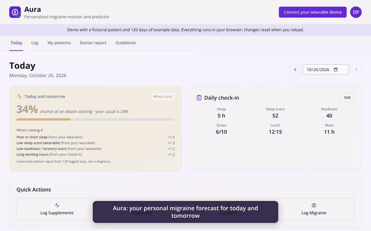
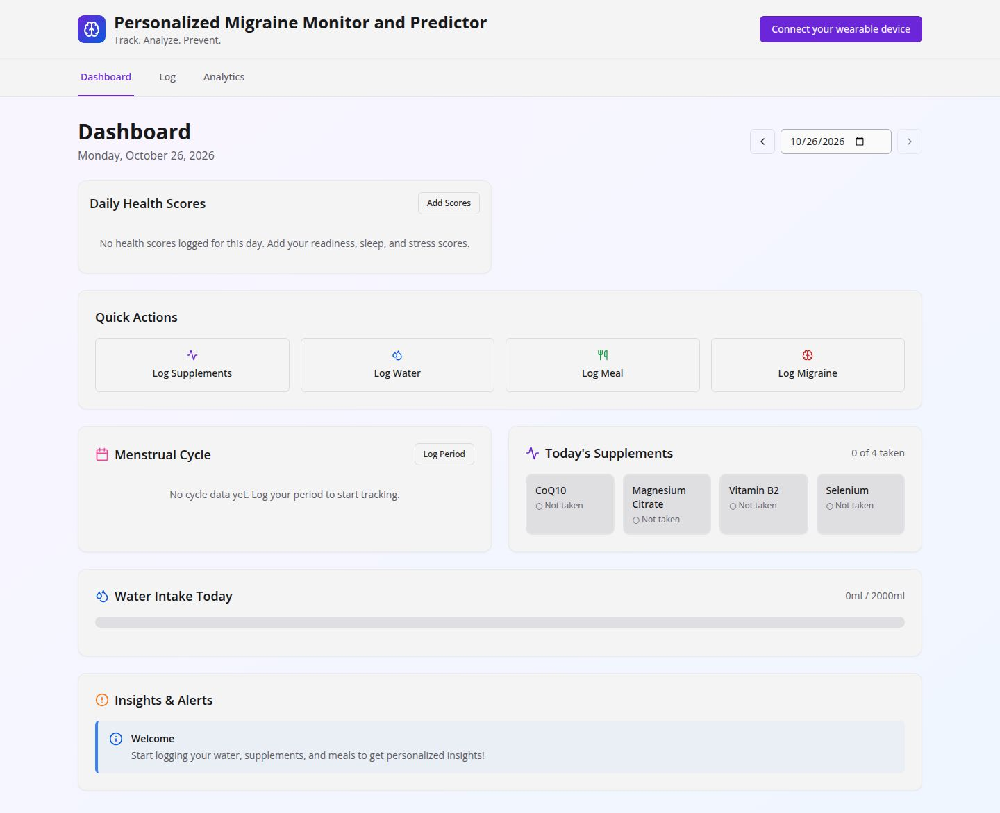
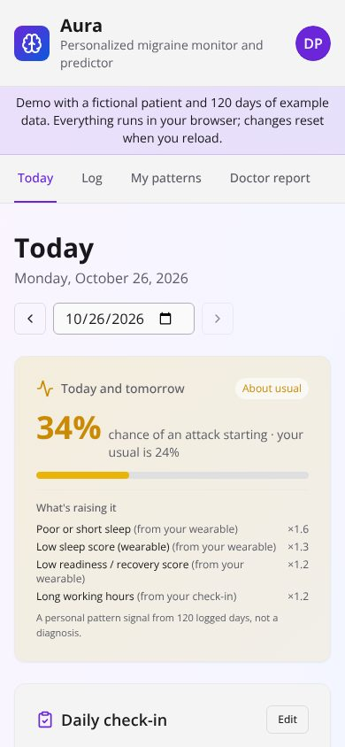
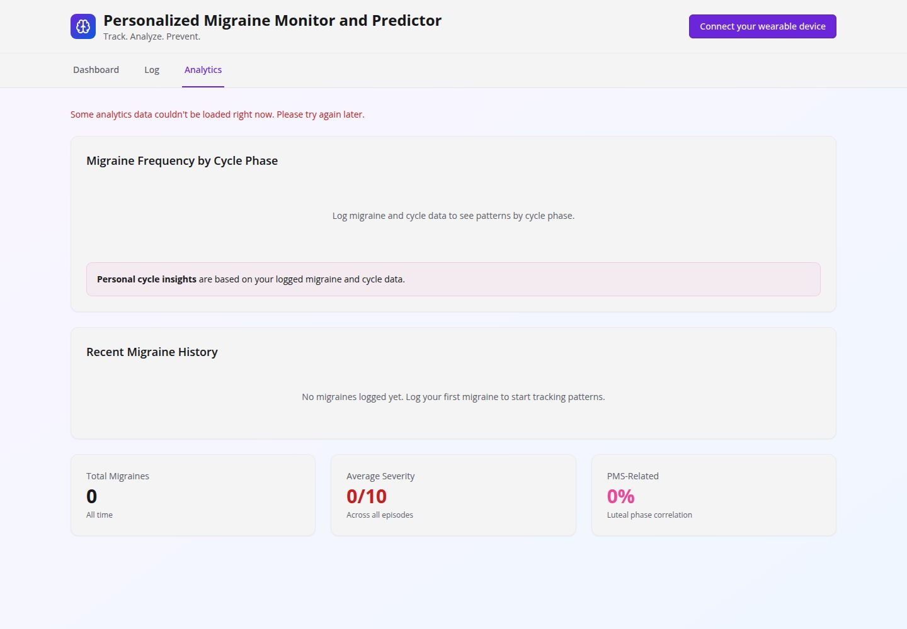

# Aura

A personalized migraine monitor and predictor.

Migraine tracking with a guideline-based clinical decision support engine. It learns each person's triggers, forecasts their risk for today and tomorrow, and produces a summary they can bring to their doctor.

## Demo (29 seconds)



[Watch the full-quality video (MP4)](docs/aura-demo.mp4). It shows a fictional patient with 120 days of example data.

To try the demo yourself, run `npm run build:demo` and open `dist/demo/migraine-demo.html` in a browser. It runs entirely in the browser and needs no server, sign-in or database.

## UX preview

**Desktop**



**Mobile**



**My patterns**



## What it does

- **Logging:** quick logs for water, meals (with time), supplements and periods (manual entry or CSV import from Clue, Flo, Fitbit, Oura or Garmin).
- **Attack log:**
  - Aura questions.
  - Doses taken from the user's own medicine list, with a 2-hour relief rating.
  - Triggers, what helped and what made it worse.
  - Red-flag checks that show an emergency prompt immediately.
- **Daily check-in:** sleep, sleep and readiness scores, stress (0–10, higher means more stress), lunch time, work hours, caffeine, exposures and early warning signs.
- **My patterns (intake):** every user records their own triggers and how often each sets off an attack, their avoidance strategies, warning signs, and what helps or makes it worse.
- **Forecast:** each trigger starts from a research value, is adjusted by the user's own answers, then by their logs. The forecast is backtested against past days. See `shared/engine/cds/riskModel.ts`.
- **Alerts:** 13 rule groups covering red flags, medication overuse (ICHD-3), prevention (AAN/AHS 2026), acute response, interactions, medicine changes, family history, supplements, patterns, wearables and data quality. Every alert links to its guideline. Alerts with clinician-only detail never reach the patient view.
- **Medicines:** the full list of everything the patient takes, plus supplements, family history and the MIDAS questionnaire.
- **Doctor report:** one printable page.
- **Talk to Aura:** a panel on every page, with a "Talk to Aura" button at the bottom right. It works without any AI key in basic mode; see [Turning on the AI features](#turning-on-the-ai-features-optional).
  - **Log it:** describe an attack or your day in your own words, typed or spoken. Aura proposes entries for the attack form and daily check-in, asks about anything missing, and saves nothing until you tap Save. A fixed warning-sign screen runs first; if it fires, Aura shows emergency guidance and the text never goes to a model.
  - **Ask:** questions about your own migraines ("What are my top triggers?", "Am I using too much medicine?"), answered only from your records and the guideline registry, with the source under every line.
  - **Aura noticed:** changes in your records worth a second look, such as a new medicine with migraine days before vs since, a new or rising trigger, a shift in migraine days, or a new kind of aura.
  - **What Aura remembers** (account menu): everything the assistant uses about you, including a life-event timeline, all of which you can check and change. There is no hidden memory.
  - **Pre-visit summary** at the top of the Doctor report, with sources and a Copy button.
- **Wearables:** each device's scoring method (ranges, bands, direction, HRV type) is built in (`shared/engine/domain/deviceScoring.ts`), so scores are read on their own scale, devices are never mixed, and each person can set their own cut-offs (for example, sleep score below 50). Oura, Fitbit, Garmin, Whoop, Polar and others connect through [Open Wearables](https://github.com/the-momentum/open-wearables), plus CSV import. Apple Watch needs a companion app or CSV export, because Apple Health has no web API.

## Running it

```bash
npm install
npm test          # engine + API tests
npm run check     # TypeScript
```

### Local development without a database

```bash
AURA_DEV_USER_ID=me npm run dev
```

This signs every request in as user `me` and stores data in memory. Use Profile → **Load demo data** to see the app with 120 days of example data. `AURA_DEV_USER_ID` is refused when `NODE_ENV=production`.

### Demo without a server

```bash
npm run build:demo   # → dist/demo/migraine-demo.html
```

This builds one self-contained page in which the app's real API (`server/api.ts`) runs inside the browser on in-memory storage, with a fictional patient. There's no server and no sign-in, nothing leaves the browser, and changes reset on reload. You can host it as a static file anywhere.

### Turning on the AI features (optional)

Aura works fully without AI. In **basic mode** (the default), Talk to Aura uses fixed rules:
- it recognises everyday wording for the app's lists (symptoms, triggers, times, your medicines) and asks about anything it can't place;
- Ask answers a fixed set of questions from your numbers;
- notes and the pre-visit summary use templates.

Nothing leaves your server.

**AI mode** uses Claude when the server has an Anthropic API key. It handles free-flowing or unusual wording, open questions, and more natural notes and summaries. It never replaces the safety parts:
- the warning-sign screen still runs first;
- every proposal is still checked against the app's lists and your own medicines;
- every answer must cite your records or a guideline, or it is removed;
- anything that contradicts Aura's rules is replaced by the rule's own flag;
- if the AI fails or declines, Aura falls back to basic mode.

To turn it on, the person who runs Aura adds the key. Never put a key in this repository.

1. **Get a key.** Sign in at [platform.claude.com](https://platform.claude.com) (formerly console.anthropic.com). This is the Claude Console, which is separate from a Claude.ai subscription; API use is billed separately, pay as you go.
   - Under **Billing**, add a card or credits and set a monthly spend limit.
   - Under **API Keys**, choose **Create Key**. The key starts with `sk-ant-` and is shown only once.
2. **Add it to the server** as `ANTHROPIC_API_KEY`:

   | Where Aura runs | Where to put it |
   | --- | --- |
   | Replit | **Secrets** tool → key `ANTHROPIC_API_KEY` |
   | Render, Fly.io and similar | The service's environment variables |
   | Your own computer | Copy `.env.example` to `.env` and fill it in (`.env` is git-ignored and loaded on start) |

3. **Restart the server.** The log says `assistant: AI mode (Claude)`, and the Talk to Aura panel says "AI mode".

Things to know:
- **Model:** `claude-opus-5-5`. Set `AURA_AI_MODEL` to use another.
- **Cost:** a typical log entry or question is one short request. Notes and the pre-visit summary are cached until the records behind them change. Each user is limited to 40 AI requests per 10 minutes; past that, Aura answers in basic mode for a few minutes.
- **Security:** keep the key on the server only. Never put it in browser code, in GitHub, or in a chat. If it leaks, delete it in the Console and create a new one.
- **Health data:** AI mode sends Claude what each request needs (the message, your medicine names, and engine summaries of your records), never the name in your profile. Before real patients use it, ask Anthropic about a HIPAA business associate agreement (BAA).
- **Guideline excerpts:** Ask quotes only from `shared/engine/domain/guidelineExcerpts.ts`, which are the registry's own statements, each marked `needs-clinician-review`. A clinician should review them before patients rely on the answers.

### On Replit / production

| Variable | Purpose |
| --- | --- |
| `DATABASE_URL` | Postgres. Then run `npm run db:push` to create or upgrade tables. |
| `REPL_ID`, `SESSION_SECRET` | Replit Auth sign-in. Every `/api` route requires a signed-in user. |
| `OPEN_WEARABLES_URL`, `OPEN_WEARABLES_API_KEY` | Optional, for device connections. The key stays on the server. |
| `ANTHROPIC_API_KEY` | Optional, turns on AI mode for Talk to Aura (see above). Leave unset for basic mode. |

Without sign-in configured, the API refuses requests rather than serve health data to anyone.

### Moving data from the first version

Old rows are kept and marked as owned by `legacy`. After signing in once, find your user id at `/api/auth/user`, then run:

```bash
npm run db:claim-legacy -- <your-user-id> America/Chicago
```

The script:

- assigns your old water, meal, supplement and period logs to your account, with local dates and times;
- copies old health scores and migraine logs into check-ins and attacks. The old stress score was a device stress-management score, where higher means calmer, so it is kept as that measure rather than turned into self-rated stress.

The old tables are not changed.

## Code map

| Path | What |
| --- | --- |
| `shared/engine/` | Decision support: domain model, guideline registry (`domain/guidelines.ts`), rules, trigger analysis, risk model. Pure functions, unit-tested. |
| `shared/assist/` | Talk to Aura: the provider interface, basic-mode rules (capture, Ask, watcher, summary), the warning-sign screen, sanitising and the citation checker. Runs in the browser demo too. |
| `server/assist/claudeProvider.ts` | AI mode. The only file that calls Claude. |
| `shared/api.ts` | Request validation used by both server and client. |
| `shared/schema.ts` | Database tables. Every table has a `user_id`. |
| `server/` | Framework-neutral API (`api.ts`) with an Express adapter (`routes.ts`), sign-in (`auth.ts`), storage (`storage.ts`), engine adapter, Open Wearables client, ML export. |
| `client/src/` | React UI. |
| `ml/` | Research export preprocessing (see `ml/KNOWN_LIMITATIONS.md`). |
| `reports/`, `research_notes/` | Literature review behind the trigger starting values and epidemiology. |

All dates are the user's local calendar dates. The client sends its time zone with every request, and the server never derives "today" from its own clock.

## Disclaimer

This is decision support, not diagnosis. Talk to Aura is not a doctor, and in an emergency it tells you to call for help. Alerts follow the cited guidelines and are meant to be reviewed with a clinician. Research-derived numbers come from published abstracts and should be checked by a clinician before clinical use.
